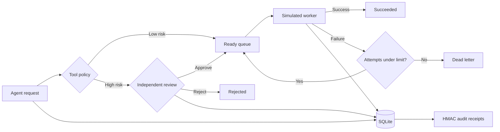

# ActionLedger — auditable AI-tool execution gateway

A small, intentionally bounded engineering project demonstrating **guarded AI-agent tool execution**, not a generic chatbot.

An agent proposes an action. Low-risk reads enter a worker queue; high-risk operations require a different human actor to approve or reject them. The gateway stores a unique request ID, guarded transitions, bounded retries, a dead-letter outcome, and HMAC-signed state-transition receipts.

> **Safety/verification:** All tool adapters are **simulators**. This project sends no actual emails, refunds no payments, and does not connect to an LLM. `x-demo-role` is a UI/demo header, **not authentication**. Do not deploy this publicly without real authorization, CSRF protections, rate limits, safe provider adapters and secret management.

## What is working in this snapshot

- TypeScript action policy, allowlisted tools, input validation and status-machine rules
- Persisted SQLite storage with unique idempotency keys and conflict detection
- An independent reviewer requirement for high-risk actions
- Atomic SQLite transitions; bounded exponential retries; explicit dead-letter state
- Signed per-transition audit receipts plus signature verification (HMAC-SHA256)
- Node.js HTTP API, a **dependency-free same-origin web console**, React 19/Vite 8 console source, and automated domain tests

**Verified locally on Linux:** `npm test` — **9 passing tests** on Node 22.16.0 (8 domain tests and 1 end-to-end HTTP integration test). The integration-test cleanup now waits for the child server to exit before deleting SQLite WAL files, with retries for Windows filesystem locks; re-test on Windows before claiming Windows compatibility. The integration test checks that the dependency-free console assets are served and validates the create → review → execute → verify flow against the real API. `node --check web/standalone.js` passes. The console itself has **not** passed a full browser interaction test here because Chromium network navigation was blocked by this environment. The React/Vite console also remains **unverified** because npm registry access was unavailable; it needs installation, typecheck, build and browser validation. Do not claim browser validation or deploy this prototype publicly.

## Run it

**On Windows:** If a test previously failed with `EBUSY` while deleting `demo.sqlite-shm`, make sure you have this updated archive. The test now waits for its server process to close before removing the SQLite directory. This is test cleanup, not an API failure.


Requires **Node 22.13+** for built-in `node:sqlite` and experimental TS type stripping.

```bash
npm test    # 9 tests run without dependencies on Node 22.13+
npm start   # API http://127.0.0.1:4400 and local console http://127.0.0.1:4400/console
```

The dependency-free **local console** is at `http://127.0.0.1:4400/console` with the server running.

For the optional React console (in another terminal; dependencies required):

```bash
cd web
npm install
npm run dev
```

The UI is at `http://localhost:5173`; Vite proxies API requests to localhost:4400. The API binds to `127.0.0.1` only; run the demo only on your computer. `npm run typecheck` requires `npm install` once at the root.

## Try it with curl

```bash
curl -X POST http://localhost:4400/actions \
 -H 'content-type: application/json' \
 -H 'x-demo-role: agent' -H 'x-demo-actor: agent-a' \
 -d '{"requestId":"refund-1001","requestedBy":"agent-a","tool":"issue_refund","payload":{"amountCents":2500,"orderId":"demo-1001"}}'
# returns an id and pending_approval; change /1 to the returned id
curl -X POST http://localhost:4400/actions/1/approve \
 -H 'x-demo-role: reviewer' -H 'x-demo-actor: reviewer-b'
curl -X POST http://localhost:4400/worker/run-once
curl http://localhost:4400/actions/1/receipts
```

Repeat the first request with the same request ID and body to see an idempotent replay; reuse the ID with different data for HTTP 409. For a failure demonstration, post `lookup_customer` with `"simulateFailure":true` and run the worker after each scheduled retry.

## Architecture



### Why this project exists

The challenge is not calling an LLM. It's making a proposed tool action observable and bounded after timeouts, repeated requests and human decisions. The core design explicitly distinguishes **request accepted**, **review approved**, **execution attempted** and **side effect succeeded**.

### Honest limitations / next iteration

1. Replace demo actor headers with authenticated sessions, tenant-scoped authorization and CSRF protection. `requestedBy` is client-provided in this demo and must not be trusted in production.
2. Replace the synchronous, single-process local SQLite worker with PostgreSQL durable leasing or a proper queue for multi-process execution; include crash recovery of `running` items and outbox semantics.
3. Replace simulated adapters with sandboxed providers only, with genuine idempotency contracts and timeout/reconciliation tests.
4. Add request schema validation with Zod, structured logs + OpenTelemetry traces, and browser end-to-end tests.
5. Add an audit key-rotation and signature chain strategy. Current HMAC proves a receipt came from this process secret, not that a database owner cannot delete or rewrite history.
6. Cap query and payload data retention, add health/readiness and abuse controls before live deployment.

## What this demonstrates in an interview

- Why a timeout is **not** proof that a provider didn't execute an action
- Why idempotency key reuse with different payloads should fail closed
- Why human approval and execution completion are **different states**
- How signed receipts differ from an immutable audit log
- How to handle retries, dead letters, and tests around failure boundaries

The repository is intentionally small enough to review in one sitting and to extend in public commits. It is **not** a production platform or a claimed shipped SaaS.

## Validation and disclosure

- ✅ Domain tests: 8 passed.
- ✅ HTTP integration test: 1 passed (real Node HTTP server; SQLite lifecycle; routes for console HTML/JS/CSS).
- ✅ JavaScript syntax: `node --check web/standalone.js`.
- ⏳ Browser click-through and mobile verification: not completed; sandbox Chromium blocks localhost and intercepted network navigation.
- ⏳ React console and root TypeScript typecheck: dependencies could not be installed because the npm registry was unreachable.
- ⏳ GitHub Actions: workflow is present but must run in the eventual new repository; no passing CI claim yet.
- 🔒 **Never expose the simulator API to the public internet.** `x-demo-role` is spoofable, `/worker/run-once` is unprotected, and a browser demo is not a substitute for real auth.
